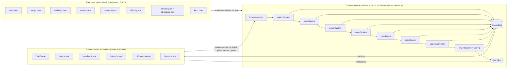
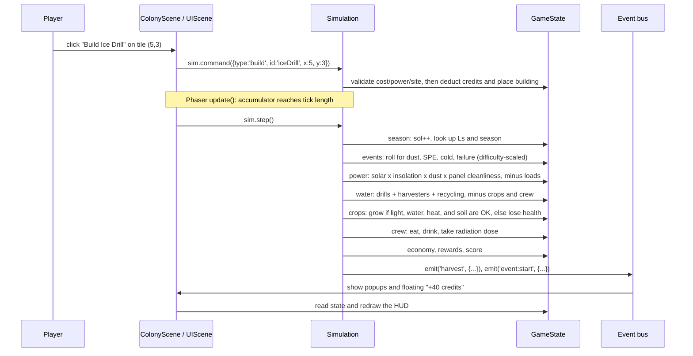
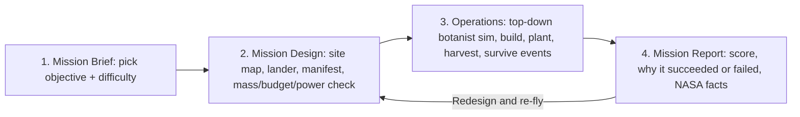

# 🌱 Red Harvest: Mars Greenhouse Mission Design Game
### NASA Space Apps Challenge 2026: *Space Mission Design Game*. Team playbook and README

> **Who this is for:** our 3-person team (Person A, Person B, and Edwin as Person C), plus any AI assistant we paste this into.
> **Time budget:** **36 hours** from kickoff of this plan (H0) to submission. All times below are relative (H0–H36).
> **Stack:** Phaser **3** + plain JavaScript + Vite, deployed to GitHub Pages.
> **Out of scope for this document:** the 30-second demo video and the slide deck.

---

## Table of contents
1. [Challenge and pitch](#1-challenge-and-pitch)
2. [What "system design" means here](#2-what-system-design-means-here)
3. [Gameplay design](#3-gameplay-design)
4. [Data sources](#4-data-sources)
5. [Folder structure and JSON schemas](#5-folder-structure-and-json-schemas)
6. [Roles](#6-roles)
7. [36-hour timeline](#7-36-hour-timeline)
8. [Build instructions, milestones, and git workflow](#8-build-instructions-milestones-and-git-workflow)
9. [Testing and the 3-minute judge demo](#9-testing-and-the-3-minute-judge-demo)
10. [Judging criteria, challenge goals, and award targets](#10-judging-criteria-challenge-goals-and-award-targets)
11. [Risks and cut list](#11-risks-and-cut-list)
12. [Prompts for AI assistants](#12-prompts-for-ai-assistants)
13. [Credits, licenses, and AI disclosure](#13-credits-licenses-and-ai-disclosure)

**Legend used throughout**
- 📡 **Real value:** comes from a cited source. Source IDs like `[S9]` point to the table in §4.
- 🎮 **Game value:** a tunable balance number we made up for gameplay. **It is not a real engineering figure.** Always label these as game values in the UI.
- ≈ **Approximation or derived value:** computed by us from a cited value. The derivation is shown.

---

## 1. Challenge and pitch

### 1.1 The official challenge (verified)
Source: **https://www.spaceappschallenge.org/2026/challenges/space-mission-design-game/** `[S1]`

Summary (quoted):
> "Your challenge is to create an interactive game that allows participants to design, manage, and simulate a complete space mission while making engineering decisions, managing limited resources, and evaluating how each choice shapes the success of their mission."

What the challenge asks for. Paraphrased from the *Objectives* and *Potential Considerations* sections of `[S1]`, and each item maps to a feature of ours:

| Challenge goal from [S1] | How Red Harvest answers it |
|---|---|
| Players **define a mission objective** before making engineering decisions | Phase 1 of the game, "Mission Brief," makes you choose 1 of 3 objectives |
| **Establish requirements, design the spacecraft/payload, choose a launch vehicle and orbit** | Phase 1, "Mission Design": choose a landing site, a cargo lander, and a starting payload manifest under **mass, budget, and power** limits. The launch-compatibility check is built in. |
| Manage **budget, mass, power, communications, data, mission lifetime** | Always-on resource dashboard: Credits, Mass, Power (W), Water (L), Food, **Data** (science), **Comms** (downlink capacity), **Time** (sols left in the mission) |
| **Every major decision has a consequence** | Example: a bigger greenhouse feeds more crew but needs more power, water, and shielding mass |
| **No single perfect solution** | Three objectives with different score weights, 6 sites, and several viable builds |
| **Random events or unexpected constraints** | Dust storms, solar particle events, cold snaps, dusty panels, equipment failures |
| **Different difficulty levels** for different knowledge levels | Easy, Medium, and Hard (§3.8) |
| **Simulate multiple times / modify and re-fly** | "Redesign and re-fly" button on the Mission Report |
| **Post-mission analysis explaining why it succeeded or failed** | Auto-generated Mission Report (§3.9) |
| **Scoring that rewards** success, science value, resource efficiency, and good decisions | Mission Performance Score + badges + reward procs (§3.9) |
| **Team play for up to 4 participants with different roles** | *Mission Control mode* (stretch goal): hot-seat roles for Botanist, Power, Water/ISRU, and Mission Planner (§3.10) |
| Explain concepts **simply, teaching *why*** | Fact cards and "Why?" tooltips on every consequence |

### 1.2 Elevator pitch
> **Red Harvest** turns a Mars greenhouse into a complete mission design problem. First you **design the mission**: pick an objective, choose a landing site using real NASA data on ice, sunlight, temperature, and soil, then pack a cargo lander under mass and budget limits. Then you **fly it** as the outpost botanist. You build greenhouses, ice drills, fertilizer makers, and solar arrays, and you plant crops whose growth times and light needs come from **NASA's life-support baseline data**. You face real Mars hazards such as dust storms in the perihelion season and solar particle events. Finally, a **Mission Report** explains *why* your mission succeeded or failed, and you redesign and fly again. Players don't just learn that Mars farming is hard. They learn which trade-offs make it hard: power vs. light-hungry crops, water vs. hydroponics, shielding mass vs. budget.

### 1.3 Why a farm is a good mission design problem
NASA's mission design resources split a mission into **launch, space, ground, and user segments** (Design and Develop Science Missions, linked in `[S1]` resources: `[S27]`). We map them onto our game:

| Mission segment [S27] | In Red Harvest |
|---|---|
| Launch segment | Choosing the cargo lander, plus the mass and budget check |
| Space/surface segment | Greenhouse, power, water, and shielding systems on the surface |
| Ground segment | Comms dish and downlink capacity: science data only counts once it has been sent to Earth |
| User segment | Crew who eat the food, and scientists who use your crop-season data (Science Points) |

### 1.4 Team note
Edwin is **Person C**. Edwin owns gathering the soil, water, and weather NASA data into JSON (see §6).

---

## 2. What "system design" means here

"System design" in a hackathon game means **deciding the parts of the software, what each part is responsible for, and how data flows between them** *before* writing code. That way 3 people can build in parallel without breaking each other's work. NASA's Mission Design Lab looks at a mission the same way, as interacting subsystems (power, thermal, communications, and so on) `[S27]`. Our code mirrors that: each Mars subsystem is its own module.

### 2.1 The 7 building blocks
| Block | What it is | Rule |
|---|---|---|
| **Scenes** (Phaser) | Screens: Boot → Title → Mission Brief → Site Map → Manifest → Colony (+UI overlay) → Report | Scenes **draw and take input only**. They never compute game rules. |
| **Simulation core** (`src/sim/`) | Pure JavaScript with **no Phaser imports**: power, water, crops, crew, events, economy, rewards | Can run in Node for tests. It is the single source of truth. |
| **Data layer** (`public/data/*.json`) | Baked-in NASA values + game balance values | Owned by Edwin. Code reads it; code never hard-codes numbers. |
| **State manager** (`src/sim/state.js`) | One plain object, `GameState`, holding everything: resources, grid, crops, sol, Ls, score | Only the sim mutates it. Scenes read it. Save = `JSON.stringify(state)`. |
| **Event bus** (`src/sim/bus.js`) | Tiny pub/sub: `bus.emit('event:start', {...})` | How the sim tells the UI something happened, without the two knowing each other |
| **Tick / sol loop** | 1 sim tick = **1 sol**. Phaser's `update()` adds up real time and calls `sim.step()` | Speeds: pause / 1× (2 sols per second) / 2× / 4×. 🎮 |
| **Economy and rewards** | Credits from harvests, Science Points from experiments that are downlinked, badges, unlocks | Lives in the sim. The UI only displays it. |

### 2.2 Architecture diagram


### 2.3 Data flow (one sol)


### 2.4 Order of systems inside `step()` (fixed order = predictable bugs)
1. `seasonSystem`: increment the sol, look up Ls, season, and month (`seasons.json`).
2. `eventSystem`: start or end events using a seeded random number generator (`mulberry32(seed)`), so the demo is repeatable.
3. `powerSystem`: generation minus demand. If there's a shortfall, shed loads in the player's priority order (life support last).
4. `waterSystem`: production minus consumption, plus storage.
5. `cropSystem`: growth, health, and harvest readiness.
6. `crewSystem`: food, water, and O₂ consumption, radiation dose, morale.
7. `economySystem`: payouts, upkeep.
8. `rewardSystem`: objectives, badges, Science Points, score. Emits events.

---

## 3. Gameplay design

### 3.1 The three phases (the core loop)

**Inside Operations (minute to minute):** check the dashboard → build or upgrade → plant crops that suit the season → respond to events → harvest → earn Credits, downlink Data for Science Points → unlock → expand.

### 3.2 Screens
| # | Scene | Player sees and does | MVP? |
|---|---|---|---|
| 1 | Title | Play, difficulty picker, (stretch) Mission Control team mode | ✅ |
| 2 | Mission Brief | Choose 1 objective card. Each card shows its score weights | ✅ (1 objective is OK) |
| 3 | Site Map | Mars map + 6 sites; panel showing 💧 ice, 🪨 soil/perchlorate, ☀️ sunlight, 🌡️ temp, ☢️ radiation, and a "why it matters" line | ✅ |
| 4 | Manifest | Pick a lander, add kit items; live mass/cost bars; red/green launch check | ✅ |
| 5 | Colony (top-down grid) | Pre-built Hab + starter solar + crew of 4; build menu, plant menu, tile info | ✅ |
| 6 | UI overlay | Credits, Mass, Power, Water, Food days, Data, Comms, Sol/Season/Ls, Radiation; speed; banners | ✅ |
| 7 | Crop Journal | Crop × season discovery grid | ⭐ |
| 8 | Mission Report | Score, stars, "3 decisions that shaped your mission," facts, Re-fly | ✅ |

### 3.3 Mission Design phase
**A. Objective** (sets the score weights) 🎮
| Objective | Win condition 🎮 | Weights 🎮 |
|---|---|---|
| 🍽️ Feed the Crew | Grow ≥ 50% of the crew's food for 1 Mars year | Food 50, efficiency 20, crew health 20, science 10 |
| 🔬 Crop Scientist | Fill ≥ 12 crop×season Journal cells **and downlink** them | Science 50, comms 20, food 15, efficiency 15 |
| 🌪️ Storm Survivor | Crew fed and power > 0 through the dust season (Ls 180–360) | Survival 50, power margin 25, food 25 |

**B. Landing site.** Coordinates are 📡 `[S8]`. The qualitative ratings are our summaries; Edwin converts them to 1–5 stars with a source note.
| Site | Coordinates | Water ice | Sunlight | Temp | Soil / notes | Trade-off taught |
|---|---|---|---|---|---|---|
| Jezero Crater | 18.44°N, 77.45°E | Low–med | Good | Moderate | Weather from MEDA `[S21]` | Balanced starter |
| Gale Crater | 4.59°S, 137.44°E | Low | Best | Warmest | Perchlorates detected at Rocknest `[S28]`; weather from REMS `[S19]` | Great power, expensive water |
| Elysium Planitia (InSight) | 4.50°N, 135.62°E | Low | Best | Warm | InSight lost almost 95% of its power to dust `[S8]` | Panel cleaning |
| Utopia Planitia (Viking 2) | 48.27°N, 134.28°E | Med–high | Medium, seasonal | Cold | – | Middle ground |
| Arcadia Planitia | Edwin picks a point in the JPL ice-map box `[S14]` | **High**: ice possibly < 30 cm deep `[S14]` | Medium | Cold | NASA's "most tempting" northern region `[S14]` | Ice vs. cold |
| Vastitas Borealis (Phoenix) | 68.22°N, 234.25°E | **Very high**: ice table ~5 cm `[S10]` | Poor | Very cold | **Perchlorate 0.4–0.6 wt%**, pH 7.7 `[S10]`; Phoenix lost power as the season changed `[S8]` | Water easy, power hard |

**C. Cargo lander + manifest (the challenge's launch-vehicle check).** 🎮 All numbers here are game values. Names are fictional (no NASA branding).
| Lander | Capacity | Cost |
|---|---|---|
| Sparrow | 1,000 kg | 300 cr |
| Condor | 2,500 kg | 600 cr |
| Titan | 5,000 kg | 1,100 cr |

Starting budget is 2,000 / 1,600 / 1,300 cr (Easy/Med/Hard) 🎮. Unspent budget becomes operating Credits. **Core trade-off:** pre-pack equipment from Earth (costs mass), or build it on Mars (costs Credits and time). The kit can include any building (mass in §3.4), seed packs (10 kg), and spare parts (50 kg, used for auto-repair) 🎮.
**Launch check:** `mass ≤ capacity` AND `landerCost + kitCost ≤ budget` AND `startPower ≥ lifeSupportLoad`. On failure, show ❌ and a "Why?" message, for example: *"Your kit is 2,740 kg but Condor carries 2,500 kg."*

### 3.4 Buildings 🎮 (all numbers are game values, tunable in `buildings.json`)
| Building | Cost cr | Kit kg | Power W (− uses) | Water L/sol | Effect | Unlock |
|---|---|---|---|---|---|---|
| Hab Core (pre-built) | – | – | −2,000 | −13 | Life support; shedding its power hurts the crew | start |
| Solar Array | 60 | 150 | +3,000 × solarFactor | 0 | Main power, affected by dust | start |
| Battery Bank | 50 | 200 | stores 20 kWh | 0 | Covers night and storms | start |
| Greenhouse Plot (soil) | 40 | 120 | −800 | −20 | 1 crop slot; needs treated soil | start |
| Hydroponic Bay | 90 | 250 | −1,200 | −12 | No soil (avoids perchlorate), +15% growth | 30 SP |
| Soil Washer | 70 | 300 | −500 | −30 per batch | Removes perchlorate for 4 plots | start |
| Fertilizer Maker | 60 | 200 | −400 | −5 | +yield to 4 nearby plots | start |
| Ice Drill | 80 | 400 | −1,000 | +60 × site iceFactor | Only good at icy sites | start |
| Atmospheric Water Harvester | 100 | 350 | −1,500 | +8 | Works anywhere, power-hungry | 20 SP |
| Water Recycler | 70 | 250 | −600 | recovers 50% | Efficiency | 20 SP |
| Regolith Shield Berm | 50 | 0 (local) | 0 | 0 | Cuts SPE damage to adjacent plots | start |
| Storm Shelter | 120 | 500 | −300 | 0 | Cuts crew dose during SPEs | 40 SP |
| Comms Dish | 80 | 150 | −400 | 0 | Downlinks Data → Science Points | start (1 small pre-built) |
| Science Lab | 90 | 300 | −600 | −2 | Needed to log Journal results | 10 SP |
| Nuclear Power Unit (Hard) | 400 | 1,500 | +10,000 | 0 | No dust penalty; heavy and expensive | 80 SP |
> Edwin: if we keep the nuclear unit, add a NASA fission surface power source link, or label it fictional.

### 3.5 Crops: real NASA numbers 📡 + computed season fit
**Source:** NASA BVAD (NASA/TP-2015-218570 Rev 2, Feb 2022) `[S9]`, **Table 4-89** (growth period, light as PPF, temperature) and **Table 4-90** (edible productivity). Crop heritage: `[S16]` `[S17]`; Mars-simulant growth `[S18]`.

| Crop | Growth (days after planting) 📡 | ≈ Sols | PPF mol/m²/day 📡 | Day °C 📡 | Dry edible g/m²/day 📡 | Fresh g/m²/day 📡 | ≈ m² per crew-member if eaten alone* | Heritage |
|---|---|---|---|---|---|---|---|---|
| Lettuce | 28 | ≈27 | 17 | 23 | 6.57 | 131.35 | ≈122 | ISS Veggie `[S16]` |
| Radish | 25 | ≈24 | 26 | 23 | 5.50 | 91.67 | ≈145 | ISS Advanced Plant Habitat `[S16]`; simulant `[S18]` |
| Pepper | 85 | ≈83 | 27 | not listed | 10.43 | 148.94 | ≈77 | ISS pepper harvests `[S17]` |
| Tomato | 85 | ≈83 | 27 | 24 | 10.43 | 173.76 | ≈77 | Simulant `[S18]` |
| White potato | 132 | ≈128 | 28 | 20 | 21.06 | 105.30 | ≈38 | Calorie crop, slow |
| Sweet potato | 85 | ≈83 | 28 | 26 | 24.7 | 51.72 | ≈32 | Highest dry yield |
| Wheat | 75–90 | ≈73–88 | **115** | 20 | 20.00 | 22.73 | ≈40 | Very light-hungry |
| Soybean | 97 | ≈94 | 28 | 26 | 4.54 | 5.04 | ≈176 | Protein, low yield |

\* Derived: BVAD Table 3-31 gives **0.800 kg dry food solids per crew-member per day** `[S9]`. Area = 800 g ÷ dry yield. This is simplified (one crop as the whole diet) and works as a Hard-mode teaching stat. Sols = days ÷ 1.0275, since a sol is 24.6597 h `[S4]`.

**How season fit stays honest.** A Mars greenhouse would be climate-controlled, so the season changes the **engineering around the crop**, not its biology:
- Power available (latitude, Ls, Sun distance, dust)
- Heating cost (outside temperature vs. the crop's target from Table 4-89)
- Storm risk (Ls 180–360 `[S7]`)

The game computes fit instead of hard-coding it:
`fit = powerAvailable(season, site) / (lightPower(PPF) + heatPower(tempC, outsideTemp))`, reduced by stormRisk × crop length 🎮 (constants are game values).

What players discover:
- Lettuce and radish (low PPF, about 24–27 sols) are the safe dust-season crops.
- Wheat (PPF 115) only works with abundant power.
- Potatoes (about 128 sols) must be planted early enough to finish before the storm season.

### 3.6 Seasons, sunlight, and the clock
| Fact | Value 📡 | Source |
|---|---|---|
| Sol length | 24.6597 h | `[S4]` |
| Mars year | 668.6 sols (687 Earth days); NASA's facts page says 669.6, Mars24 gives 668.59 | `[S6]` `[S7]` `[S5]` |
| Northern season lengths | Spring 194, Summer 178, Autumn 142, Winter 154 sols | `[S5]` |
| Ls | 0° N. spring equinox, 90° summer solstice, 180° autumn equinox, 270° winter solstice | `[S6]` |
| Perihelion / aphelion | Ls ≈ 251° / Ls ≈ 71° | `[S6]` / `[S7]` |
| Dust storm season | Ls 180–360 | `[S7]` |
| Sol → Ls | 12 "months" of 30° Ls each, with sol ranges (month 1 = sols 0–61.2 … month 12 = 612.9–668.6) | `[S7]` |
| Mean sunlight at top of atmosphere | 586.2 W/m² (43% of Earth's) | `[S4]` |
| Distance perihelion / aphelion | 206.650 / 249.261 million km → ≈1.45× more sunlight at perihelion (derived) | `[S4]` |
| Obliquity | 25.19° | `[S4]` |
| Surface pressure | 6.36 mbar = 0.636 kPa mean; 0.40–0.87 kPa seasonal | `[S4]` |
| Temperature | Average ≈ −59 °C; Viking 1 daily range −89 to −31 °C | `[S4]` |

**Insolation (simplified; label it approximate in game):** `δ = asin(sin 25.19° · sin Ls)` `[S6]`; `cosZ = max(0, cos(lat − δ))`; `solarFactor = cosZ × distanceFactor(Ls) × dustFactor × panelCleanliness`. dustFactor and cleanliness are 🎮 game values. Southern sites flip season names.
**Clock:** 1 tick = 1 sol; 1× = 2 sols/sec, so a Mars year ≈ 5.6 min (≈ 1.4 min at 4×). Crop times stay real in sols; only the playback is faster.

### 3.7 Events
| Event | Real basis 📡 | Effect 🎮 | Counter-play |
|---|---|---|---|
| 🌪️ Regional dust storm | Storm season Ls 180–360 `[S7]`; driven by southern-summer heating `[S13]` | solar ×0.4 for 10–30 sols; chance ×4 in season | Batteries, low-PPF crops |
| 🌑 Global dust storm (Hard) | 2018: tau **10.8** at Opportunity, which then went silent `[S13]` | solar ×0.05 for 40–60 sols; max 1 per game | Reserves, nuclear unit |
| 🟤 Dusty panels | InSight lost almost 95% of its power to dust `[S8]` | −0.3% output per sol until cleaned | Cleaning action |
| ☢️ Solar particle event | DONKI catalog `[S22]`; baseline surface dose 0.67 mSv/day `[S11]` | Crew dose spike; unshielded crops −30% health | Berms, shelter |
| 🥶 Cold snap | Viking 1 lows of −89 °C `[S4]` | Heating ×1.5 for 5 sols | Power margin |
| 🔧 Equipment failure | Generic risk (not a NASA statistic) | Random building offline | Spare parts (mass trade-off) |
| ⚗️ Perchlorate | Phoenix 0.4–0.6 wt% `[S10]` | Untreated plot yields 0 and is flagged "unsafe" | Soil Washer or hydroponics |

**Real data driving events:** Edwin pulls one past year of SEP events from the DONKI API `[S22]` (≤ 60-day query windows). The sim replays the **gaps** between events as sols. The UI says "archived NASA space-weather pattern, not live." Caveat: DONKI events are mostly measured near Earth, so we use them as a timing pattern, not as Mars dose values.
**Hard-mode radiation card:** about 1 Sv for a reference mission (180-day transit + 500 days on the surface + 180-day return) `[S12]`.

### 3.8 Difficulty scaling
| Aspect | 🟢 Easy (≈8–11, new to Mars) | 🟡 Medium (teens / public) | 🔴 Hard (high school+ / space fans) |
|---|---|---|---|
| Units | Icons and bars | Rounded numbers | **W, kWh, L, sols, kPa, mSv, Ls°** |
| Budget 🎮 | 2,000 | 1,600 | 1,300 |
| Events 🎮 | ×0.5, 1-sol warning | ×1.0, warning | ×1.3, no warning, global storm possible |
| Crop failure | Pause instead of dying | Slow health loss | Die after 3 unpowered sols |
| Perchlorate | Auto-treated | Needs a Washer | Washer + contamination checks |
| Radiation | Flavor text only | Crew health meter | mSv dose + shelter decisions |
| Crew needs | Fixed | Fixed | BVAD values per crew-member per day: O₂ 0.895 kg, potable water 3.217 kg, dry food 0.800 kg `[S9]` |
| Help | Tutorial arrows | Tooltips | "Why?" cards only |

### 3.9 Reward system, scoring, and report
**Currencies:**
- **Credits** 🪙 from harvests (fresh kg × value × quality 🎮).
- **Science Points** 🔬, earned only when Journal data is **downlinked** by the comms dish. This teaches the challenge's data and communications constraint.
- **Data** (MB 🎮), buffered until downlinked. Comms capacity per sol drops during storms.

**Reward procs** 🎮
| Proc | Trigger | Reward |
|---|---|---|
| 🌟 Perfect Harvest | Roll: 10% + 5% per sol with fit ≥ 1 during the crop's cycle | ×2 credits |
| 🧪 New Discovery | First harvest of a crop in a new season | +15 SP after downlink; Journal cell lights up |
| 🛡️ Storm Survivor | Event ends with 0 crop losses | +50 cr, badge progress |
| 🔥 Fed Streak | Crew fed 30 sols in a row | +10% harvest value while the streak lasts |
| 📦 Supply Drop | A seasonal objective is completed | Pick 1 of 3 cards (seeds / parts / credits) |

- **Seasonal objectives:** 3 per season from templates.
- **Badges:** 🥬 First Salad, 🧊 Ice Miner, 🌪️ Storm Chaser, ☢️ Shielded, 📡 Data Hero, 🧑‍🚀 Self-Sufficient, ♻️ Water Wizard.
- **Unlocks (SP):** Lab 10 → Harvester/Recycler 20 → Tomato/Pepper 25 → Hydroponics 30 → Shelter 40 → Wheat/Soybean 50 → Nuclear 80.
- **Mission Performance Score (0–100):** Σ objective weight × component%, minus penalties. Stars at 50 / 70 / 85 🎮.
- **Mission Report:** score bars; "3 decisions that shaped your mission" from `state.decisions` (e.g., "Phoenix gave +60 L/sol water, but solar averaged 35%"); 2–3 NASA fact cards; **Re-fly** with a score comparison.

### 3.10 Mission Control team mode (stretch; the challenge suggests teams of up to 4)
- Hot-seat on one device. Roles: 🌱 Botanist, ⚡ Power Engineer, 💧 ISRU Engineer, 📋 Mission Planner.
- Each role must approve the manifest. Events trigger a council vote with 2–3 options.
- The report adds a coordination bonus.
- Implementation: the active role filters the build menu, plus a "Next role" button. No networking.

---

## 4. Data sources
Links checked 2026-11-14 (PT).

| ID | Source | URL | Used for |
|---|---|---|---|
| S1 | **Official challenge: Space Mission Design Game** | https://www.spaceappschallenge.org/2026/challenges/space-mission-design-game/ | Requirements and objectives |
| S2 | Space Apps Global Awards | https://www.spaceappschallenge.org/awards/ | Award targets |
| S3 | Space Apps Project Submission Guide | https://www.spaceappschallenge.org/resources/project-submission-guide/ | Judging criteria, AI (SI) rules, NASA-data eligibility |
| S4 | NASA NSSDC Mars Fact Sheet | https://nssdc.gsfc.nasa.gov/planetary/factsheet/marsfact.html | Sol, irradiance, pressure, temps, orbit, obliquity |
| S5 | NASA Science: Mars Facts | https://science.nasa.gov/mars/facts/ | Season lengths |
| S6 | NASA GISS Mars24 technical notes | https://www.giss.nasa.gov/tools/mars24/help/notes.html | Ls, declination, perihelion |
| S7 | LMD Martian seasons and Ls table *(non-NASA, Mars Climate Database team)* | https://www-mars.lmd.jussieu.fr/mars/time/solar_longitude.html | Sol → Ls months, dust season, aphelion |
| S8 | NASA GISS Mars24: Mars Landers | https://www.giss.nasa.gov/tools/mars24/help/landers.html | Site coordinates; Phoenix and InSight power notes |
| S9 | **NASA BVAD 2022** | https://ntrs.nasa.gov/citations/20210024855 (PDF: https://ntrs.nasa.gov/api/citations/20210024855/downloads/BVAD_2.15.22-final.pdf) | Crew needs (Table 3-31); crops (Tables 4-89, 4-90) |
| S10 | Hecht et al. 2009, Phoenix perchlorate (PubMed) | https://pubmed.ncbi.nlm.nih.gov/19574385/ | 0.4–0.6 wt% perchlorate, pH, ~5 cm ice table |
| S11 | SwRI: Curiosity RAD surface radiation | https://www.swri.org/newsroom/press-releases/swri-scientists-publish-first-radiation-measurements-the-surface-of-mars | 0.67 mSv/day |
| S12 | NASA: Radiation exposure comparisons | https://science.nasa.gov/resource/radiation-exposure-comparisons-with-mars-trip-calculation/ | ~1 Sv reference mission |
| S13 | NASA JPL: Opportunity and the 2018 dust storm | https://www.jpl.nasa.gov/news/opportunity-hunkers-down-during-dust-storm/ | tau 10.8 |
| S14 | NASA JPL: Treasure Map for Water Ice on Mars | https://www.jpl.nasa.gov/news/nasas-treasure-map-for-water-ice-on-mars/ | Arcadia, ice < 30 cm |
| S15 | SWIM: Subsurface Water Ice Mapping | https://swim.psi.edu/ | Ice maps. ⚠️ HTTP 523 when checked; use S14 if it's still down |
| S16 | NASA: Growing Plants in Space; Veggie fact sheet | https://www.nasa.gov/exploration-research-and-technology/growing-plants-in-space/ ; https://science.nasa.gov/wp-content/uploads/2023/04/veggie_fact_sheet_508.pdf | Crop heritage |
| S17 | NASA: Second pepper harvest on ISS | https://www.nasa.gov/missions/station/nasas-second-pepper-harvest-sets-record-on-space-station/ | Pepper |
| S18 | Wageningen (Wamelink): crops in Mars/Moon simulants *(non-NASA)* | https://research.wur.nl/en/publications/crop-growth-and-viability-of-seeds-on-mars-and-moon-soil-simulant-2/ | Plausibility |
| S19 | Curiosity REMS weather | https://mars.nasa.gov/msl/weather/ | Gale temps |
| S20 | InSight weather | https://mars.nasa.gov/insight/weather/ | Elysium temps/pressure |
| S21 | Perseverance MEDA weather | https://mars.nasa.gov/mars2020/weather/ | Jezero temps |
| S22 | NASA CCMC DONKI | https://ccmc.gsfc.nasa.gov/tools/DONKI/ ; API `https://ccmc.gsfc.nasa.gov/DONKI-API/get/SEP?startDate=YYYY-MM-DD&endDate=YYYY-MM-DD` | SEP timing |
| S23 | PDS MSL RAD data | https://pds-ppi.igpp.ucla.edu/data/MSL-M-RAD-3-RDR-V1.0/ | Optional dose chart |
| S24 | PDS MGS MOLA | https://pds-geosciences.wustl.edu/missions/mgs/mola.html | Map/elevation |
| S25 | NASA Mars Trek | https://trek.nasa.gov/mars/ | Site exploration |
| S26 | NASA Image Library API; NASA media guidelines | https://images-api.nasa.gov/search?q=mars ; https://www.nasa.gov/nasa-brand-center/images-and-media/ | Map image (no logos) |
| S27 | Challenge resources: Design and Develop Science Missions; Mission Design Lab; JPL Concept Maturity Levels; Webb build-it game; CubeSat 101 | https://www.nasa.gov/wp-content/uploads/2025/04/250323-design-and-develop-science-mission.pdf ; https://etd.gsfc.nasa.gov/capabilities/integrated-design-center/mission-design-lab/ ; https://dataverse.jpl.nasa.gov/dataset.xhtml?persistentId=hdl:2014/44299 ; https://science.nasa.gov/mission/webb/game-build-it-yourself/ ; https://www3.nasa.gov/sites/default/files/atoms/files/nasa_csli_cubesat_101_508.pdf | Mission-segment framing |
| S28 | Glavin et al. 2013, perchlorates at Rocknest, Gale | https://earthsciences.gsfc.nasa.gov/sed/content/uploadFiles/publication_files/Glavin_et_al-2013-Journal_of_Geophysical_Research__Planets.pdf | Gale soil |

**Tools and assets**
| What | URL | Note |
|---|---|---|
| Phaser **3.90.0** (pin it; `npm i phaser` now installs Phaser 4.x) | https://github.com/phaserjs/phaser/releases | MIT |
| Vite GitHub Pages guide | https://vite.dev/guide/static-deploy | Workflow below copied from here |
| Kenney packs (Tiny Farm, Tiny Town, Space Kit, UI Pack, Game Icons, Planets) | https://kenney.nl/assets | CC0 |
| OpenMoji | https://openmoji.org/ | CC BY-SA 4.0, attribution required |
| game-icons.net | https://game-icons.net/ | CC BY 3.0, attribution required |

---

## 5. Folder structure and JSON schemas
```
mars-farm/
├─ index.html  package.json ("type":"module")  vite.config.js
├─ .github/workflows/deploy.yml
├─ public/
│  ├─ data/      ← Edwin: sites, crops, buildings, events, seasons, difficulty, landers, objectives, facts (.json)
│  └─ assets/    ← Kenney PNGs, mars-map.jpg, CREDITS.md
├─ src/
│  ├─ main.js  config.js
│  ├─ sim/       ← Person A, NO Phaser imports
│  │  ├─ Simulation.js  state.js  bus.js  rng.js  insolation.js  design.js
│  │  └─ systems/ season.js events.js power.js water.js crops.js crew.js economy.js rewards.js
│  ├─ scenes/    ← Person B: Boot Title Brief Map Manifest Colony UI Report (…Scene.js)
│  └─ ui/        ← buttons, panels, tooltip, formatUnits(value, kind, difficulty)
└─ test/sim.test.js
```

**Rule:** every number in the JSON is either sourced (`"_src": "S9"`) or marked `"_game": true`. Use `null` for values that aren't filled yet. Tests fail on `null`, so we never guess.

```json
// sites.json (one entry)
{ "id": "jezero", "name": "Jezero Crater", "lat": 18.44, "lon": 77.45, "_src_coords": "S8",
  "mapX": 0.715, "mapY": 0.398, "stars": { "ice": 2, "sun": 4, "temp": 3, "soil": 3 },
  "iceFactor": 0.3, "_game_iceFactor": true,
  "tempSamples": [{ "Ls": 0, "minC": null, "maxC": null }], "_src_temps": "S21",
  "why": "Balanced sunlight; little shallow ice.", "factCardId": "jezero-1" }
```
mapX = (lon+180)/360 and mapY = (90−lat)/180 for an equirectangular map. Convert east longitudes > 180 to negative first.

```json
// crops.json (one entry)
{ "id": "lettuce", "name": "Lettuce", "emoji": "🥬", "growthDays": 28, "growthSols": 27,
  "ppf": 17, "tempDayC": 23, "yieldDry_g_m2_d": 6.57, "yieldFresh_g_m2_d": 131.35,
  "_src": "S9 BVAD Tables 4-89, 4-90", "value_cr_per_kg": 4, "_game_value": true, "unlockSP": 0 }

// buildings.json (one entry)
{ "id": "iceDrill", "name": "Ice Drill", "sprite": "drill", "cost": 80, "massKg": 400,
  "powerW": -1000, "waterLPerSol": 60, "scalesWith": "site.iceFactor", "unlockSP": 0, "_game": true,
  "why": "Most Mars water is frozen underground; icy sites make drills worthwhile (S14)." }

// events.json (two entries)
{ "id": "dustRegional", "icon": "🌪️", "baseChancePerSol": 0.004,
  "seasonMultiplier": { "LsFrom": 180, "LsTo": 360, "x": 4 }, "durationSols": [10, 30],
  "effects": { "solarFactor": 0.4 }, "_game": true, "fact": "Dust storm season: Ls 180-360 (S7)." }
{ "id": "spe", "icon": "☢️", "schedule": "replayDonki", "donkiGapsDays": [], "_src_schedule": "S22",
  "effects": { "crewDose_mSv": 0, "unshieldedCropHealth": -0.3 }, "_game_effects": true }

// seasons.json
{ "yearSols": 668.6, "months": [{ "month": 1, "LsFrom": 0, "LsTo": 30, "solFrom": 0.0, "solTo": 61.2 }],
  "seasonNamesNorth": ["Spring", "Summer", "Autumn", "Winter"], "_src": "S7" }

// difficulty.json: { "easy": { "budget": 2000, "eventMult": 0.5, "units": "icons", "cropDeath": false, ... }, ... }
// facts.json: { "id": "rad-1", "text": "Curiosity measured about 0.67 mSv/day of cosmic-ray dose at the surface.", "source": "S11" }
```
The `mapX`/`mapY` values in the Jezero example are computed from its coordinates.

**GameState (Person A owns; everyone reads)**
```js
{ seed, difficulty, objectiveId, siteId, landerId, sol: 0, Ls: 0, seasonIdx: 0, speed: 1,
  res: { credits, sp, data, waterL, foodKg, batteryWh, massUsed },
  power: { gen, demand, solarFactor, priority: [], shed: [] },
  crew: { n: 4, health: 1, morale: 1, dose_mSv: 0, fedStreak: 0 },
  grid: { w: 16, h: 12 }, buildings: [{ uid, id, x, y, online, dust }],
  crops: [{ uid, plotUid, cropId, plantedSol, health, growth }],
  events: { active: [], log: [] }, journal: {}, objectives: {}, badges: [],
  decisions: [{ sol, text, effect }], score: { total: 0, parts: {} } }
```

**Interface contract (freeze at H2)**
```js
class Simulation { constructor(data, { seed, difficulty, objectiveId, siteId, landerId, manifest });
  step(); command(cmd) /* build|demolish|plant|harvest|clean|repair|setPriority → {ok, reason} */;
  get state(); on(evt, fn); off(evt, fn); }
checkManifest(data, { landerId, items, budget }) // → { ok, massKg, cost, reasons: [] }
// Bus events: sol, harvest, event:start, event:end, proc, badge, objective:done, crop:died, power:shortage, mission:end
```

---

## 6. Roles
| | **Person A: Sim/Engine lead** | **Person B: Gameplay/UI/Scenes** | **Edwin (Person C): Data/Science/Content + README/QA/Submission** |
|---|---|---|---|
| Owns | `src/sim/**`, `test/**`, vite config, deploy workflow | `src/scenes/**`, `src/ui/**`, `public/assets/**` | `public/data/**`, README, CREDITS, submission text |
| Deliverables | Simulation + 8 systems, seeded RNG, insolation, `checkManifest`, headless 1-year test, demo mode | 8 scenes, build/plant menus, HUD with difficulty units, banners, Report, Journal | All JSON with sources: soil (S10/S28), water (S14/S15), weather (S19–S21), crops (S9), SEP gaps (S22); 20+ fact cards; "why" texts; QA; submission |
| First 2 hours | Scaffold, pin Phaser 3.90.0, deploy "Hello Mars" | Pick Kenney packs; Boot/Title; grid with placeholder rectangles | **Stub JSON in the agreed schema** so A and B are never blocked |
| Done when | 669-sol test passes for all difficulties and sites | Full loop playable at 1280×720, no overlaps | Every UI number traces to an S# or is labeled 🎮 |
| Backup for | B | A (economy) | B (UI copy), A (balance) |

Standups take 5 minutes, at H2, H6, H10, H14, H20, H24, H28, and H32. Track work in a `TODO.md` with Doing / Blocked / Done.

---

## 7. 36-hour timeline
| Hours | Person A (Sim) | Person B (UI) | Edwin (Data/QA) | Gate |
|---|---|---|---|---|
| H0–H1 | Repo, Vite, `phaser@3.90.0`, base, workflow | Assets, paper sketches | Stub all JSON | Everyone runs `npm run dev` |
| H1–H2 | state, bus, rng, Simulation skeleton | Boot (loads JSON), Title, scene flow | Crops (S9) + seasons (S7) real values | **H2: contract frozen** |
| H2–H6 | season, power, water, crops, insolation | MapScene + ColonyScene grid and placement | Sites (S8, S14, S19–S21, S10, S28), buildings, difficulty | **H6: first merge** |
| H6–H10 | crew, economy, `command()`, `checkManifest` | HUD + menus wired to `command()`, ManifestScene | events + DONKI gaps (S22), 10 fact cards, playtest | **H10: build → plant → harvest** |
| H10–H14 | events system, basic score, headless test | Banners, floating text, speed controls, basic Report | Objectives, landers, balance pass 1 | **H14: 🚩 MINIMUM PLAYABLE DEMO deployed** |
| H13–H19 | Works to H14.5 | Works to H14.5 | 😴 **Sleep H13–H19** | |
| H14.5–H20 | 😴 Sleep | 😴 Sleep | H19–H20: smoke-test the live build, write the bug list | |
| **H20** | Standup | Standup | Bug list | **🚩 CUT-LINE REVIEW: if the MVP loop isn't solid, H20–H28 is fixes only** |
| H20–H24 | Difficulty hooks, procs, Journal, comms/data | Unit formatting, Journal screen, Easy tutorial | 20+ facts, "why" texts, report texts | H24: 3 difficulties |
| H24–H28 | Badges, objectives, decision log, re-fly | Tweens, map polish, (stretch) team mode | Balance pass 2, README draft | **H28: 🧊 FEATURE FREEZE** |
| H28–H32 | Bug fixes; demo mode | Bug fixes; layout | QA checklist; CREDITS; AI disclosure | H32: release candidate |
| H32–H34 | 45-min nap (rotate), fixes | 45-min nap (rotate), fixes | Run the demo script 3× on the live URL; submission text | **H34: tag v1.0** |
| H34–H36 | Buffer (demo-breaking bugs only) | Buffer | **Submit by H35**; test links in a private window | H36: deadline |

---

## 8. Build instructions, milestones, and git workflow
```bash
npm create vite@latest mars-farm -- --template vanilla
cd mars-farm && npm install
npm install phaser@3.90.0      # PIN v3, plain "npm i phaser" installs v4
git init && git add . && git commit -m "scaffold"
git remote add origin https://github.com/<you>/mars-farm.git && git branch -M main && git push -u origin main
```
In `package.json`, add `"type": "module"` and the scripts `"dev": "vite"`, `"build": "vite build"`, `"preview": "vite preview"`, `"test": "node --test test/"`.

**vite.config.js**
```js
import { defineConfig } from 'vite';
export default defineConfig({
  base: '/mars-farm/',             // must equal the repo name
  build: { assetsInlineLimit: 0 },
});
```
Load data in `BootScene.preload()` with `` this.load.json(k, `${import.meta.env.BASE_URL}data/${k}.json`) ``.

**.github/workflows/deploy.yml** (from the Vite guide, with a test step added). Then set GitHub → Settings → Pages → Source: **GitHub Actions**.
```yaml
name: Deploy static content to Pages
on:
  push:
    branches: ['main']
  workflow_dispatch:
permissions:
  contents: read
  pages: write
  id-token: write
concurrency:
  group: 'pages'
  cancel-in-progress: true
jobs:
  deploy:
    environment:
      name: github-pages
      url: ${{ steps.deployment.outputs.page_url }}
    runs-on: ubuntu-latest
    steps:
      - name: Checkout
        uses: actions/checkout@3d3c42e5aac5ba805825da76410c181273ba90b1 # v7
      - name: Set up Node
        uses: actions/setup-node@949feb2413d6458794dcd2491c4babbbce0c15c1 # v7
        with:
          node-version: lts/*
          cache: 'npm'
      - run: npm ci
      - run: npm test
      - run: npm run build
      - name: Setup Pages
        uses: actions/configure-pages@45bfe0192ca1faeb007ade9deae92b16b8254a0d # v6
      - name: Upload artifact
        uses: actions/upload-pages-artifact@fc324d3547104276b827a68afc52ff2a11cc49c9 # v5
        with:
          path: './dist'
      - name: Deploy to GitHub Pages
        id: deployment
        uses: actions/deploy-pages@368f82528645a54fb793d4d04e342629a3f51346 # v5
```
If an action fails, re-copy the workflow from https://vite.dev/guide/static-deploy.

**main.js:** a `Phaser.Game` at 1280×720 with `scale: { mode: Phaser.Scale.FIT, autoCenter: Phaser.Scale.CENTER_BOTH }`, `pixelArt: true`, and the scene list [Boot, Title, Brief, Map, Manifest, Colony, UI, Report].
**Tick in ColonyScene.update:** `this.acc += delta * speed; while (this.acc >= 500) { sim.step(); this.acc -= 500; }` (500 ms = 2 sols/sec at 1× 🎮).

**Milestones** (each one deployed):
- M0 H1: Hello Mars is live
- M1 H6: map → site → grid, and the sol counter ticks
- M2 H10: plant lettuce, harvest at ~27 sols, credits rise
- **M3 H14 MVP:** Brief → Map → Manifest check → Colony → dust storm → Report
- M4 H24: difficulties, Journal, procs, unlocks
- M5 H28: freeze
- v1.0 H34

**Git rules:**
- Branches `a/sim`, `b/ui`, `c/data`. Only touch the folders you own.
- `main` must always build. Before every merge: `git pull origin main` → `npm test && npm run build` → merge → push.
- Merge at every checkpoint. Use small commits (`feat(sim): water system`).
- Never force-push `main`. If you break it, fix it now or run `git revert <sha>`.
- Tag `v0.1-mvp` at H14 and `v1.0` at H34.

---

## 9. Testing and the 3-minute judge demo
**Automated (CI):**
- All JSON loads with no `null` numbers.
- 669 sols × each difficulty × each site (seed 42): no NaN, water ≥ 0, credits ≥ 0, Ls wraps correctly.
- An overweight manifest fails with a reason that mentions mass.
- Lettuce is harvestable at sol 27 ± 1 under full power.

**Manual QA (Edwin):**
- [ ] Each difficulty plays start to report with no console errors.
- [ ] Every site panel shows a source.
- [ ] Every Hard-mode number has a unit.
- [ ] Every event shows a banner and a fact.
- [ ] Re-fly shows the score comparison.
- [ ] Works in Chrome and Firefox, in a private window, on the live URL.

**Demo mode:** `?demo=1` sets a fixed seed and Medium difficulty. Keys: `1` dust storm · `2` SPE · `F` +30 sols · `]` 4× speed · `R` jump to the report.

| Time | On screen | Say |
|---|---|---|
| 0:00–0:20 | Medium → objective **Feed the Crew** | "Real missions start with an objective: grow half the food for 4 crew for a Mars year." |
| 0:20–0:50 | Hover Phoenix (ice ★★★★★, sun ★), then Gale (sun ★★★★★, ice ★); pick Utopia | "Phoenix found ice about 5 cm down, plus toxic perchlorate, and lost power as winter came. No perfect site, just trade-offs." |
| 0:50–1:20 | Overpack → ❌ over Condor's capacity → remove a battery → ✅ | "Like a launch vehicle, our lander has a mass limit. Packing from Earth costs mass; building on Mars costs time." |
| 1:20–2:00 | At 4×: solar, ice drill, soil washer, 2 plots; lettuce + potato; 🌟 Perfect Harvest | "Growth times and light needs come from NASA's life-support baseline data." |
| 2:00–2:30 | Press `1`: dust storm → power shortage → greenhouse lights shed; battery saves life support | "Dust season runs Ls 180–360. In 2018 a storm like this silenced Opportunity." |
| 2:30–3:00 | Press `R`: Report, 3 key decisions, Journal, Re-fly | "The game explains *why*, and you redesign and fly again. That's mission design." |

---

## 10. Judging criteria, challenge goals, and award targets
The official criteria are **Impact, Creativity, Validity, Relevance, Presentation** `[S3]`.

| Criterion | Our evidence |
|---|---|
| Impact | Free browser game, 3 difficulty levels from kids to high school; teaches the system-level trade-offs that `[S1]` says students rarely get to experience |
| Creativity | A mission design game where the "spacecraft" is a farm: crop × season discovery, a mass-limited manifest, events driven by real data |
| Validity | 📡/🎮 labels on every number; BVAD crop tables; season fit computed from power and heat; headless sim tests |
| Relevance | §1.1 maps every `[S1]` objective to a feature: objective → design → launch check → operations → report → re-fly |
| Presentation | Scripted 3-minute demo, live Pages link, clean README |

**Coverage of `[S1]`:**
- ✅ objective · requirements/launch check · "spacecraft" design · launch vehicle · budget, mass, power, comms, data, time · random events · difficulty levels · scoring · post-mission analysis · re-simulate
- ⭐ team play for up to 4 (stretch)
- **Honest gap:** we don't simulate orbits. Landing-site choice is our analog, which `[S1]` allows ("creative alternatives… while preserving the fundamental trade-offs").

**Global Awards** (names verified on `[S2]`):
- Primary: **Best Mission Concept** ("most plausible concept and design") and **Best Use of Science**.
- Secondary: **Most Inspirational** and **Best Use of Data**.
- Stretch: Galactic Impact, Art & Technology.
- Eligibility `[S3]`: use at least one NASA data or resource, and keep all links public.

---

## 11. Risks and cut list
| Risk | Mitigation |
|---|---|
| Scope creep | MVP at H14, cut-line review at H20, freeze at H28 |
| Phaser 4 installed by accident | `phaser@3.90.0`; check `package.json` |
| Blank page on Pages | `base: '/<repo>/'` + `BASE_URL` for data |
| Sim and UI drift apart | Contract frozen at H2; event bus |
| Unsourced numbers | Edwin's rule: S# or 🎮 |
| Endless balancing | Tune only 3 knobs: event multiplier, budget, crop value |
| Art time sink | Kenney + emoji + rectangles only |
| A source site is down | Data is baked in; S14 backs up S15 |

**Cut in this order:** 1 team mode → 2 nuclear unit + global storm → 3 save/load → 4 sound → 5 DONKI replay (use random SPEs) → 6 badges → 7 tech tree → 8 Journal screen (keep popups) → 9 extra objectives.
**Never cut:** Brief, Map with real data, manifest mass check, build/plant/harvest, dust storm, Report with "why," and at least the Easy vs. Hard difficulty split.

---

## 12. Prompts for AI assistants
> **Space Apps SI/AI rule `[S3]`:** AI tools are allowed to speed up work, but **not to come up with how to solve the challenge**. Acknowledge AI-generated code and data in descriptive text and metadata, watermark any AI images, and **never generate NASA logos or branding**. Put `// AI-assisted (<tool>)` at the top of AI-assisted files and log them in §13.

**Master prompt (paste first):**
```
You are helping a beginner-intermediate 3-person team build "Red Harvest" for the NASA Space Apps
2026 challenge "Space Mission Design Game"
(https://www.spaceappschallenge.org/2026/challenges/space-mission-design-game/): an interactive game
where participants design, manage and simulate a complete space mission, making engineering
decisions, managing limited resources (budget, mass, power, communications, data, time) and
evaluating how each choice shapes success, with difficulty levels, random events, scoring and a
post-mission analysis.
Concept: Mars greenhouse outpost. Phase 1 Mission Design: choose objective; choose landing site
from real NASA data; choose cargo lander + manifest under mass/budget limits (launch check).
Phase 2 Operations: top-down grid, player is the botanist, colony pre-built (hab, power, 4 crew);
build solar, batteries, greenhouse plots, hydroponics, soil washer (perchlorate), fertilizer
maker, ice drill, water harvester, recycler, shield berm, storm shelter, comms dish, science lab;
plant/harvest crops for credits; downlink data for science points; survive dust storms, solar
particle events, cold snaps, dusty panels, failures. Phase 3 Mission Report explaining why, then
Redesign & re-fly.
Constraints: Phaser 3.90.0 (NOT 4), plain JS ES modules, Vite, GitHub Pages base '/mars-farm/',
no backend/live APIs/TypeScript. src/sim/ must not import Phaser (runs in Node tests). All numbers
come from public/data/*.json; never hard-code or invent real-world values; real values carry an
S# source id, balance values are marked game values. 1 tick = 1 sol; systems order: season,
events, power, water, crops, crew, economy, rewards; seeded RNG mulberry32. Difficulty: easy icons,
medium rounded numbers, hard real units (W, kWh, L, sols, kPa, mSv, Ls).
Contract: class Simulation {constructor(data,opts); step(); command(cmd)->{ok,reason}; get state;
on(); off();}  checkManifest(data,{landerId,items,budget})->{ok,massKg,cost,reasons[]}.
Bus events: sol, harvest, event:start, event:end, proc, badge, objective:done, crop:died,
power:shortage, mission:end. Write simple, commented, beginner-readable code. Return complete
files with the path on the first line plus a 3-line "how to test".
```
**Module prompts (paste after the master prompt; add the README section mentioned):**
- **A1 Sim core:** "Write state.js, bus.js, rng.js, Simulation.js per the GameState in §5. `command()` validates build/plant/harvest/clean/repair/setPriority and logs major choices to `decisions[]`."
- **A2 Season + insolation:** "seasons.json months table (year 668.6 sols), linear Ls inside each month, declination asin(sin 25.19°·sin Ls), noon factor, distance lookup, southern-hemisphere flip, tests for Ls at sols 0/193.3/371.9/514.6."
- **A3 Power/water/crops/crew:** "Load shedding by priority (life support last); iceDrill × site.iceFactor; crop growth 1/growthSols per sol when powered, watered, treated, and heated, else health loss; crew consumption from difficulty.json; emit power:shortage and crop:died."
- **A4 Events/economy/rewards:** "Chance × season × difficulty, durations, effects, replayDonki gaps; payouts; procs (Perfect Harvest, New Discovery, Storm Survivor, Fed Streak, Supply Drop); SP only after downlink; score with objective weights; stars." (paste §3.7 and §3.9)
- **A5 Tests:** "node:test: 669 sols × difficulties × sites (seed 42), no NaN or negatives; overweight manifest fails with a mass reason; lettuce ready at sol 27±1."
- **B1 Menu scenes:** "Boot (JSON via BASE_URL), Title, Brief (objective cards), Map (sites at mapX/mapY, hover panel showing stars or real numbers by difficulty, why + source), Manifest (lander cards, +/- items, mass/cost bars, checkManifest with a Why? tooltip). Graphics + Text UI, 1280×720."
- **B2 Colony + UI:** "16×12 grid, build/plant menus, click to harvest, accumulator tick with speeds 0/1/2/4, bus-driven banners and floating text; UIScene HUD with `formatUnits(value, kind, difficulty)`. No game rules in scenes."
- **B3 Report + Journal:** "Score bars, stars, top 3 decisions, 2–3 facts with sources, badges, Re-fly keeping the objective and showing the score delta; Journal grid of crops × 4 seasons."
- **C1 Data (Edwin):** "Turn these sourced tables (§3.3–3.7) into JSON matching §5 schemas. Keep values exact, mark game values, add `_src` ids, leave `null` and list it when unsourced. Do not invent real numbers."
- **C2 Facts (Edwin):** "Write 25 fact cards (≤ 25 words, easy/medium/hard versions) ONLY from these sourced facts, plus a one-sentence 'Why?' for every building and event, explaining the benefit and the cost."

---

## 13. Credits, licenses, and AI disclosure
- **Code:** MIT. **Art:** Kenney (CC0), OpenMoji (CC BY-SA 4.0), game-icons.net (CC BY 3.0); attributions go in `public/assets/CREDITS.md`. NASA imagery follows `[S26]`. **No NASA logos or insignia.**
- **Data:** §4. In-game label: "archived NASA data, not live."
- **AI disclosure `[S3]`:**

| File / asset | AI tool | What it did |
|---|---|---|
| _(fill in during the hackathon)_ | | |

*📡 values were checked against their linked sources on 2026-11-14. 🎮 values are starting balance numbers: change them freely, but keep the label.*
